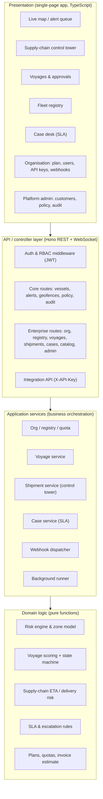
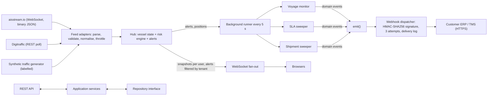
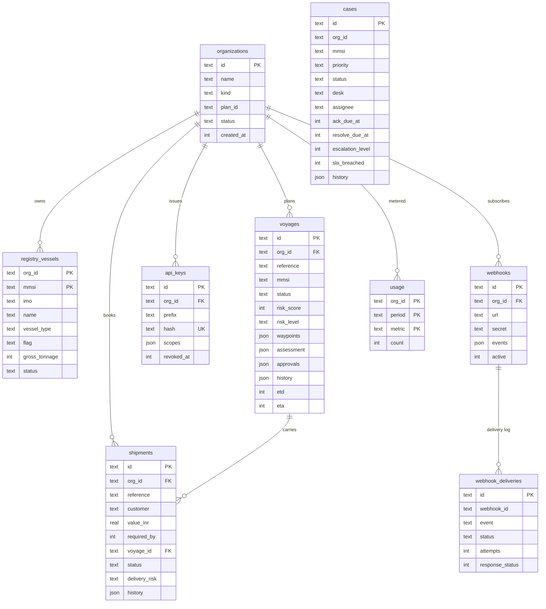
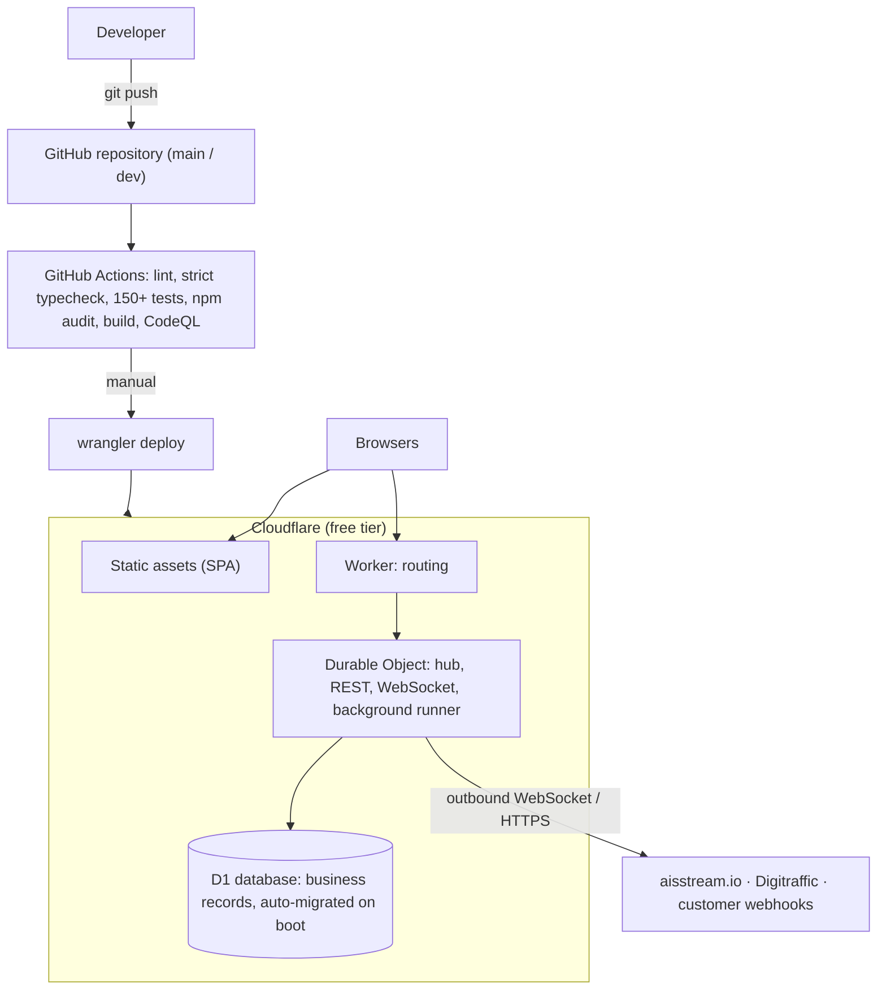

# ORVMS — Architecture

Four views of the multi-tier design. Diagrams are Mermaid (render on GitHub, VS Code, or <https://mermaid.live>).

## 1. Logical layer — what the user sees and how requests are orchestrated

## 2. Technical layer — services, messaging and data translation

Key translations: AIS message type → `PositionReport` → normalised `Vessel` (flag from MMSI MID, category from ship type); route template → sampled polyline → exposure by zone → risk score; vessel position + voyage → projected ETA → delivery risk; domain event → signed JSON envelope.

## 3. Data layer — relational schema (Cloudflare D1 / SQLite)

*Operational (non-relational) state:* live vessel positions, alerts, watchlists, geofences, users (identity) and the audit trail live in the Durable Object's storage; they are high-churn and rebuilt from the feed. *Reference data in code:* ports, route templates, plans, Coast Guard stations, modelled zone geometry.

## 4. Infrastructure layer — repository, CI/CD and runtime

Environments: local (`npm run dev` demo, `npm run live` with local D1), staging/production (Cloudflare), CI. Secrets only via `wrangler secret` / `.dev.vars` (git-ignored).
